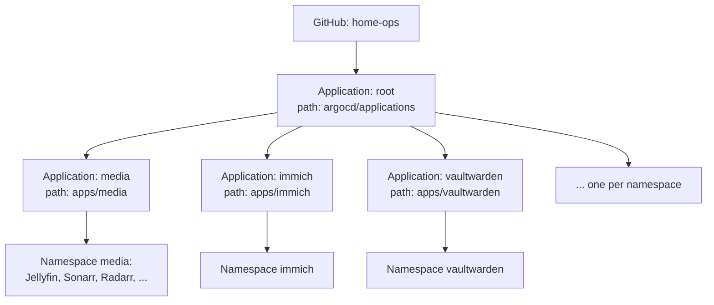
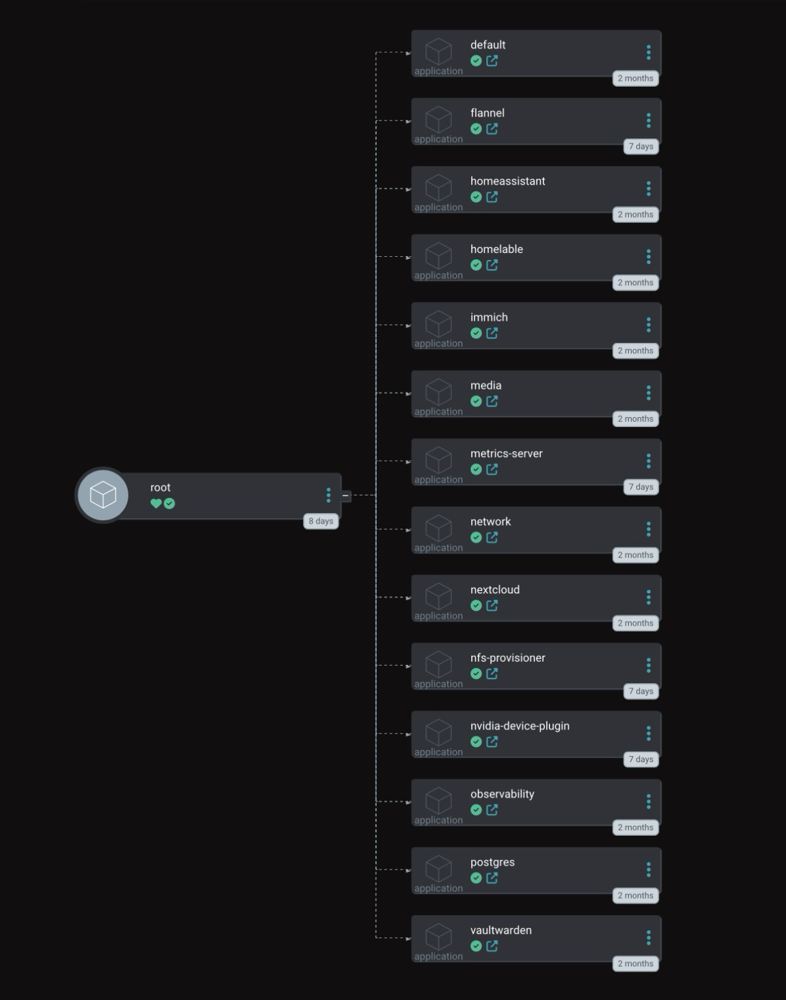
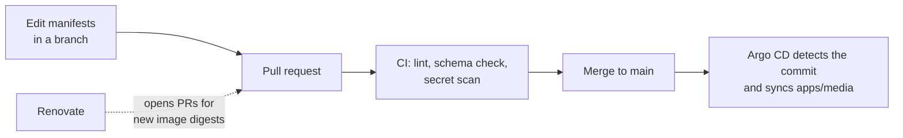
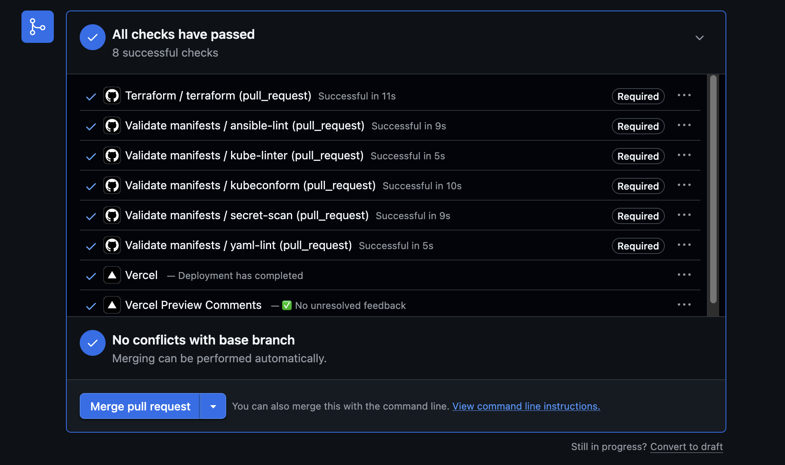
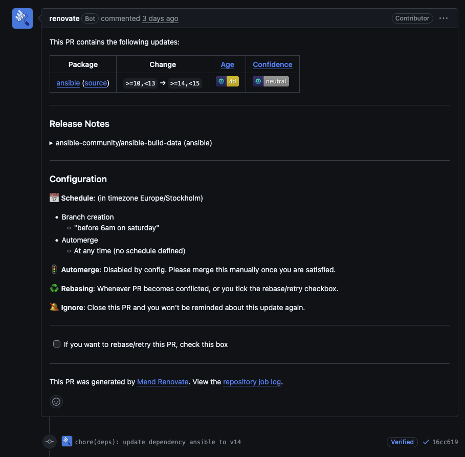
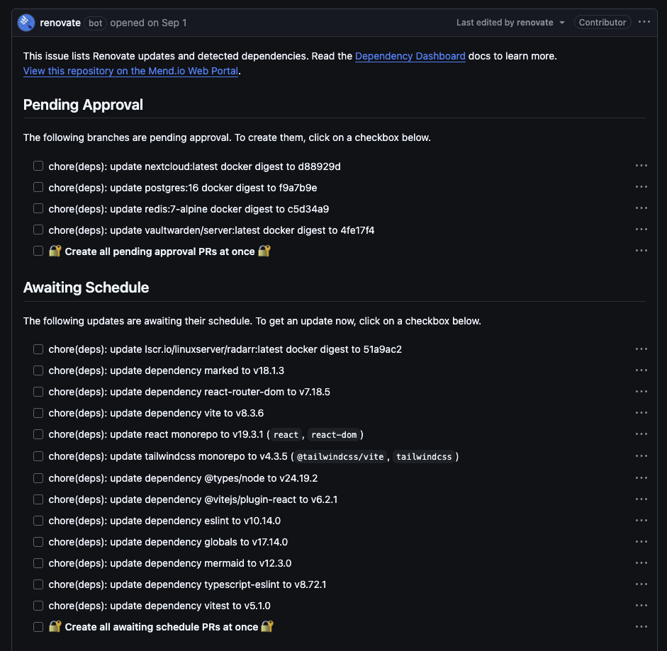

## Introduction

I do not run `kubectl apply` against my cluster. When I want to change something, I edit a YAML file in a Git repository, open a pull request, let CI check it, and merge. Argo CD sees the new commit and makes the cluster match it.

This post is a walkthrough of that path in my homelab: what is in the repository, how Argo CD is wired to it, what CI checks, how secrets and image versions are handled, and what I do after a bad day and need to rebuild. It also lists what is not covered yet, because the setup has gaps.

The first post, [the homelab overview](/blog/my-homelab-building-my-own-infrastructure), only touched on this. Everything below is in my public repository, [home-ops](https://github.com/Megjafari/home-ops).

## The goal

The rule I am trying to keep is simple: **the repository is the only way in.** If something runs in the cluster, there is a file in Git that says so. If I lose the cluster, the repository plus a small number of documented steps should be enough to build it again.

I did not start there. The first version of the cluster was configured by hand with `kubectl`, and the state lived in my head and in shell history. That works until a node dies, or until you have to remember why you changed a setting three months ago.

## The setup in one picture

Two machines make up the Kubernetes cluster, installed with `kubeadm`:

| Machine | Role |
| --- | --- |
| Intel NUC `nuke` | Control plane |
| Self-built server `tank` | Worker with an RTX 3060, and NFS storage on two disks in RAID 1 |

The ThinkPad T430s runs Proxmox with OPNsense and Coolify. It is not part of the cluster and is not covered here.

Each layer has one owner:

| Layer | Owner | Lives in |
| --- | --- | --- |
| Hosts: packages, swap, containerd, NVIDIA driver | Ansible | `ansible/` |
| Cluster bootstrap and node membership | `kubeadm` | `docs/cluster-components.md` |
| Everything that runs in Kubernetes | Argo CD | `apps/`, `argocd/` |

Ansible stops at the edge of the host. Argo CD owns everything inside the cluster. The two never overlap, which keeps it clear where to look when something is wrong.

## The repository

The parts that matter for this post:

```text
.
├── .github/workflows/validate.yml   # CI: lint, schema checks, secret scan
├── ansible/                         # host configuration
├── apps/                            # one directory per namespace
│   ├── media/
│   ├── immich/
│   ├── vaultwarden/
│   └── ...
├── argocd/
│   ├── root.yaml                    # the app-of-apps entry point
│   └── applications/                # one Application per directory in apps/
├── docs/                            # backup and cluster-components
├── scripts/backup-sealed-secrets-key.sh
└── renovate.json
```

`apps/media/` holds the media stack: Jellyfin, Navidrome, Sonarr, Radarr, Prowlarr, Jellyseerr and qBittorrent behind a VPN sidecar. Each app is a Deployment, a PersistentVolumeClaim and a Service in plain YAML. I do not use Helm or Kustomize for my own apps. The files are long, but you can read them top to bottom, which I prefer at this size.

## How Argo CD finds everything: app of apps

An Argo CD `Application` is a small resource that says: take the manifests at this path in this repository, and keep this namespace in sync with them.

I have one per namespace. This is the one for media:

```yaml
apiVersion: argoproj.io/v1alpha1
kind: Application
metadata:
  name: media
  namespace: argocd
spec:
  project: default
  source:
    repoURL: https://github.com/Megjafari/homelab.git
    targetRevision: HEAD
    path: apps/media
  destination:
    server: https://kubernetes.default.svc
    namespace: media
  syncPolicy:
    automated:
      prune: false
      selfHeal: false
```

The `Application` resources themselves are also kept in Git, in `argocd/applications/`. To avoid creating each one by hand, there is one more Application above them, called `root`:

```yaml
apiVersion: argoproj.io/v1alpha1
kind: Application
metadata:
  name: root
  namespace: argocd
spec:
  project: default
  source:
    repoURL: https://github.com/Megjafari/homelab.git
    targetRevision: HEAD
    path: argocd/applications
  destination:
    server: https://kubernetes.default.svc
    namespace: argocd
  syncPolicy:
    automated:
      prune: false
      selfHeal: false
```

`root` watches the folder with the other Application files. This pattern is called *app of apps*. Adding a new namespace means adding one file under `argocd/applications/` and one directory under `apps/`. The only manual step in the whole system is `kubectl apply -f argocd/root.yaml`, once, on a new cluster.



This is how it looks in Argo CD. `root` on the left, and the 14 Applications it manages on the right:



### Adopting a cluster that already existed

I want to be honest about how this came about. The cluster existed first. The Argo CD Applications were created with the UI and the CLI, so they only lived inside the cluster. The files in `argocd/applications/` are an export of what was running, with the status and runtime metadata stripped out. I added the `root` Application on 1 November, after the fact.

That has a consequence for components I installed before I had this workflow: the NFS provisioner, Flannel, metrics-server and the NVIDIA device plugin. They run in the cluster already, installed by hand. I describe each as an Application in Git, but **without automated sync**:

```yaml
  # No automated sync on purpose: this adopts a release that was installed
  # with `helm install`. Review the diff in ArgoCD, then sync by hand.
```

Applying them with sync enabled would let Argo CD replace running infrastructure based on my reconstruction of how it was installed, and my reconstruction might be wrong. So I open each in the UI, check that the diff is empty or harmless, and sync it once. The NFS provisioner, for example, is described as a Helm chart pinned to version `4.0.18`, with the server address and the `nfs-storage` StorageClass as values.

Syncing them was not always smooth. The first sync of `flannel` failed on one resource, the DaemonSet, with `spec.selector: field is immutable`. The running DaemonSet had been installed from an older manifest and selected pods with two labels, `app` and `k8s-app`. The manifest at the version I had pinned only has `app`. A selector cannot be changed, so Argo CD could never make them match. I deleted the DaemonSet with `--cascade=orphan`, which leaves the pods running, and synced it again from Git. The new DaemonSet adopted the running pods, and nothing restarted. The steps are in [`docs/cluster-components.md`](https://github.com/Megjafari/home-ops/blob/main/docs/cluster-components.md).

## Two settings that are off on purpose

Every Application uses automated sync, with two options set to `false`:

- **`prune: false`**: if I delete a file from Git, Argo CD does not delete the resource from the cluster. It reports the resource as out of sync, and I delete it myself.
- **`selfHeal: false`**: if someone changes a live resource directly, Argo CD does not revert it.

The risk I am guarding against is a mistake in Git turning into data loss. A file moved to the wrong folder or an accidental rename looks like a deletion, and with prune on, a PVC could go with it. I would rather have a leftover to clean up than a missing photo library. These options are on my list to turn on, but only after I have off-host backups of application data, which I do not have yet.

This is not only theory. The `network` Application stayed OutOfSync even though its sync had succeeded. I had removed UniFi and MongoDB from Git, but two PVCs and a sealed secret were still in the cluster, and with `prune: false` Argo CD only reported them. Once I was sure I did not need them, I deleted the volumes by hand. The NFS provisioner has `archiveOnDelete` on, so the data was moved to an `archived-` directory instead of being removed. After that, `network` was Synced.

## Following one change

Here is the full path of a change, using Jellyfin as the example.



### 1. The manifest

This is the Jellyfin Deployment, trimmed:

```yaml
apiVersion: apps/v1
kind: Deployment
metadata:
  name: jellyfin
  namespace: media
spec:
  replicas: 1
  strategy:
    type: Recreate
  template:
    spec:
      nodeSelector:
        kubernetes.io/hostname: tank
      containers:
      - name: jellyfin
        image: jellyfin/jellyfin:latest@sha256:fea863d0cd9e...
        startupProbe:
          tcpSocket:
            port: 8096
          periodSeconds: 10
          failureThreshold: 30
        resources:
          requests:
            cpu: 200m
            memory: 512Mi
          limits:
            nvidia.com/gpu: 1
```

Three lines in this file carry most of what I have learned, and I come back to them below: `strategy: Recreate`, the `nvidia.com/gpu` limit and the digest on the image.

### 2. CI on the pull request

`validate.yml` runs on every pull request to `main`:

| Job | Tool | What it catches |
| --- | --- | --- |
| `yaml-lint` | yamllint | Syntax errors, duplicate keys, bad structure in `apps/` |
| `kubeconform` | kubeconform v0.6.7 | Manifests that are not valid Kubernetes objects, checked against the 1.31.0 schemas |
| `kube-linter` | kube-linter v0.7.2 | Bad practice: no resource limits, running as root. **Advisory** |
| `ansible-lint` | ansible-lint | Problems in the host playbooks |
| `secret-scan` | gitleaks v8.24.3 | Passwords and keys in the full Git history |



`kubeconform` runs with `-ignore-missing-schemas`. I first tried it with a catalog of CRD schemas, but it rejected the output of Sealed Secrets, so I dropped the catalog. The cost is that custom resources such as `SealedSecret` and `Application` are not schema-checked.

`kube-linter` runs with `continue-on-error: true`, with a comment in the workflow explaining why: the manifests still lack security contexts and some resource settings. In the pull request above it is marked Required and shows green. That is true, and also slightly misleading: the job has to run, but it can never fail. I would rather have the check visible and failing quietly than switched off. Making it blocking is on the to-do list.

One more detail on gitleaks. The usual GitHub Action builds a commit range for pull requests and failed on my repository, because the blog history was imported with a root commit that has no parent. So I run the gitleaks CLI directly in Docker and scan the whole history instead.

### 3. Merge and sync

After merge, Argo CD detects the new commit on `main`, renders `apps/media` and compares it with the live objects. The changed Deployment is applied. I do not run anything.

There is nothing special about the sync itself. What matters is the two steps before it: the change is reviewed in a pull request, and it has passed the checks.

## Why Jellyfin uses `Recreate`

This is a failure that taught me how Kubernetes handles updates.

By default a Deployment uses a rolling update: start the new pod, wait until it is ready, then stop the old one. That is good for stateless apps. It broke twice for me.

**The GPU.** `tank` has one GPU, and Jellyfin asks for `nvidia.com/gpu: 1`. During a rolling update the new pod could not be scheduled, because the old pod still held the only GPU. The new pod stayed `Pending`. The old pod could not stop until the new one was ready. It stayed like that for hours.

**The locked data directory.** Databases and Prometheus had a similar deadlock. The new pod started while the old one was still running and tried to open the same data directory. The database holds a lock on it, so the new pod crash-looped, and the rollout never finished.

The fix in both cases is `strategy: Recreate`: stop the old pod first, then start the new one. It costs a short downtime on every update. For a single-replica home service I accept that. I now set `Recreate` on every single-replica app with a PVC.

## Image versions

### Pinned by digest

Most of my images came from `:latest`. In a GitOps setup that makes the Git history meaningless. The file says `latest` both before and after, so a diff shows nothing, and a revert does not take you back to anything.

Now every image carries a digest, the fingerprint of one exact build:

```yaml
image: jellyfin/jellyfin:latest@sha256:fea863d0cd9ec445985d9c75fc6ed64e38a1d2766cf0c250a33d553f4fc1b771
```

I keep the tag for readability. The digest decides what is pulled. When I introduced this I pinned each image to **the digest that was already running**, so the commit changed nothing in the cluster. Pinning to whatever was newest would have mixed a cleanup with an unplanned upgrade.

### Renovate keeps them current

Pinning without updates would freeze the cluster. Renovate opens a pull request when a digest changes. Its configuration is short:

```json
{
  "extends": ["config:recommended", "docker:pinDigests"],
  "timezone": "Europe/Stockholm",
  "schedule": ["before 6am on saturday"],
  "kubernetes": { "managerFilePatterns": ["/^apps/.+\\.yaml$/"] },
  "packageRules": [ ... ]
}
```

It only looks for updates early on Saturday, so I get one batch a week and not a stream. The `packageRules` encode which updates I do not want to think about:

- **Immich server and machine-learning are grouped.** They must run the same version, so they are updated in one pull request.
- **Major upgrades of PostgreSQL, Redis and Immich's Postgres are disabled.** A major version upgrade of a database needs a manual migration. A bot should not open that PR.
- **Stateful and critical services only update when I tick them in the Dependency Dashboard.** That covers PostgreSQL, Redis, Vaultwarden, Nextcloud and `cloudflared`. A bad update there is expensive, so a human decides when.
- Nothing is merged automatically (`automerge: false`).

Renovate's pull requests go through the same CI as mine. Each one is a normal pull request that I merge myself. Automerge is off:



The things that need my approval are listed in the Dependency Dashboard, an issue that Renovate keeps up to date. The databases, Vaultwarden and Nextcloud wait there until I tick the box. Everything else waits for Saturday morning:



## Secrets

If the repository describes everything, it has to describe the secrets too. The VPN credentials for the download client are an example. They cannot sit in plain text in a public repository.

I use **Sealed Secrets**. The controller in the cluster has a private key. I encrypt a secret with the matching public key, and the encrypted `SealedSecret` is safe to commit:

```yaml
apiVersion: bitnami.com/v1alpha1
kind: SealedSecret
metadata:
  name: mullvad-credentials
  namespace: media
spec:
  encryptedData:
    WIREGUARD_ADDRESSES: <ciphertext>
    WIREGUARD_PRIVATE_KEY: <ciphertext>
```

When Argo CD applies it, the controller decrypts it into a normal `Secret` in the same namespace. Only that cluster can decrypt it.

### The scanner that flagged the ciphertext

gitleaks looked at the encrypted values and flagged them as leaked secrets. They are ciphertext, so they are not, but the scanner cannot know. I did not disable the check. I added an allowlist in `.gitleaks.toml` that matches only sealed secret files:

```toml
[allowlist]
description = "SealedSecrets hold values encrypted with the cluster's public key; they are safe to commit"
paths = ['''(^|/)[^/]*sealed-secret\.yaml$''']
```

A plaintext password in any other file still fails the build. The weakness is the file name: a real secret saved as `something-sealed-secret.yaml` would slip through. For now I accept that.

### The key is the one thing Git cannot rebuild

Every sealed secret is encrypted to the controller's private key. If the key is lost, none of them can be decrypted, and each secret must be created again. The repository cannot help, because the key is not in it.

So there is a script, `scripts/backup-sealed-secrets-key.sh`, that exports the key and encrypts it with AES-256 under a passphrase. The result must be stored in at least two places outside the cluster. The controller creates a new key every 30 days and keeps the old ones, so a backup only contains the keys that existed at that time. The backup has to be repeated at least monthly and whenever I seal a new secret. To restore, the key is applied before Argo CD syncs the apps, and the controller is restarted. The procedure is in `docs/backup.md`.

## Rebuilding

This is the part the whole setup is meant to serve. The order, from `docs/cluster-components.md`:

1. Prepare the hosts with Ansible, then `kubeadm init` and `join`.
2. Apply Flannel.
3. Install Argo CD, then the Sealed Secrets controller.
4. Restore the Sealed Secrets key.
5. `kubectl apply -f argocd/root.yaml`, then sync the four manual Applications once.
6. Install Reloader.

After step 5, Argo CD creates the Applications and each Application creates its workloads.

### The time I had to do it

I moved the cluster from `192.168.8.0/24` to `192.168.1.0/24`. I expected a small change. Then the API server became unreachable:

```text
dial tcp 192.168.8.100:6443: i/o timeout
```

The API server certificate and `--apiserver-advertise-address` were bound to the old IP address of `nuke`, and the IP of a `kubeadm` control plane cannot simply be changed. I could have patched the certificates. I chose to rebuild the cluster from scratch instead. From the first error until everything was running again took me about five to six hours.

This was not the clean "Git brings everything back" story I had expected. Here is what actually happened, in order:

1. **Kubernetes itself.** `kubeadm reset`, clean up CNI state and iptables, then `kubeadm init` with the new address `192.168.1.8`. A CNI bug came back, so I had to copy `/opt/cni/bin` to `/usr/lib/cni` on both nodes. Then `tank` joined again.
2. **Argo CD** was installed again and connected to `home-ops`.
3. **Leftovers from the old network.** Two things still pointed at the old subnet:
   - The default route on `nuke` was still `192.168.8.1`. Image pulls hung and the UniFi pod sat in `Pending`. I fixed it with `ip route del` and `ip route add default via 192.168.1.1`.
   - The NFS export on `tank` still allowed `192.168.8.0/24`, so the NFS provisioner hung in `ContainerCreating`. I changed the export to `192.168.1.0/24`, ran `exportfs -ra` and restarted `nfs-kernel-server`.
4. **UniFi and MongoDB came up first**, because `network` was the only Application I had recreated.
5. **Then I noticed that most things were missing**: Postgres, Immich, media, Grafana and Homepage. I created the five Applications (`postgres`, `default`, `immich`, `media`, `observability`) by hand in Argo CD. `media` showed `Missing` until I turned on automated sync. Postgres and Immich complained about a missing `postgres-credentials`, because the sealed secrets had been encrypted for the old controller and had to be sealed again for the new one.
6. **Cleanup last.** Homepage needed new links, NodePorts on `192.168.1.8` and an updated `HOMEPAGE_ALLOWED_HOSTS`, and the Tailscale route had to change to `192.168.1.0/24`.

Argo CD did roll out the workloads once an Application existed. But it was far from hands-off. I reinstalled Argo CD, created Applications by hand, sealed secrets again, and fixed NFS, the default route, Homepage and Tailscale manually.

### What the rebuild changed in the repository

The rebuild is why this repository looks the way it does now. It exposed three weaknesses, and each one has a fix in Git:

- **The Applications only existed in the cluster.** When the cluster went away, so did the definitions of what should run. That is why I exported them to `argocd/applications/` and added the `root` Application. Today, restoring them is one `kubectl apply -f argocd/root.yaml`, not five Applications clicked together from memory.
- **The sealed secrets depended on a key I had not backed up.** The new controller could not decrypt the old secrets. That is why `scripts/backup-sealed-secrets-key.sh` and `docs/backup.md` exist.
- **The rebuild order lived in my head.** It is now written down in `docs/cluster-components.md`, including the components I installed by hand.

The subnet change also left old addresses in places that Git does not cover: the default route, the NFS export, and the Tailscale route. Those are host and network settings, which is the argument for putting more of them in Ansible.

## What is not in Git

- **Argo CD itself, the Sealed Secrets controller and Reloader** were installed with a command. The command is documented, but it is not an Application, and there is no automatic update for these. Reloader is the weakest: it has no Helm release in the cluster, so the install line in the docs is a best guess based on the version. I note this in the docs so I do not trust it blindly.
- **Application data.** Git restores the apps, not the photos in Immich or the files in Nextcloud. RAID 1 protects against one failing disk, not against losing `tank`. There is no off-host backup of the NFS data yet.

## Known gaps

- No NetworkPolicies. The CNI is Flannel, which does not enforce them, so pods can reach each other freely.
- Most workloads run as root. Only Grafana and Prometheus have a hardened `securityContext`.
- Services are exposed as `NodePort`. There is no ingress controller yet.
- `kube-linter` is advisory, because of the two points above.
- `prune` and `selfHeal` are off.
- Terraform manages the GitHub repository and the Cloudflare DNS zone. Proxmox is not covered yet.

## What I learned

1. **Make Git the only way in.** The first time you fix something directly on the server, Git stops being the truth.
2. **The default update strategy assumes you have spare capacity.** A single GPU, or a database that locks its directory, breaks that assumption.
3. **Pin to what is running before you update.** Separate "describe the current state" from "change the state".
4. **A scanner you cannot trust gets switched off.** I narrowed the gitleaks rule rather than removing it.
5. **List what Git cannot restore.** For me that is the secrets key and the application data, and both need their own backup plan.

## What's next

- Off-host backups of the NFS data.
- NetworkPolicies, which means moving away from Flannel or adding an enforcing CNI.
- Security contexts and non-root containers, then making `kube-linter` blocking.
- Turning on `prune` and `selfHeal` once the backups exist.
- Putting Argo CD itself under Argo CD.
